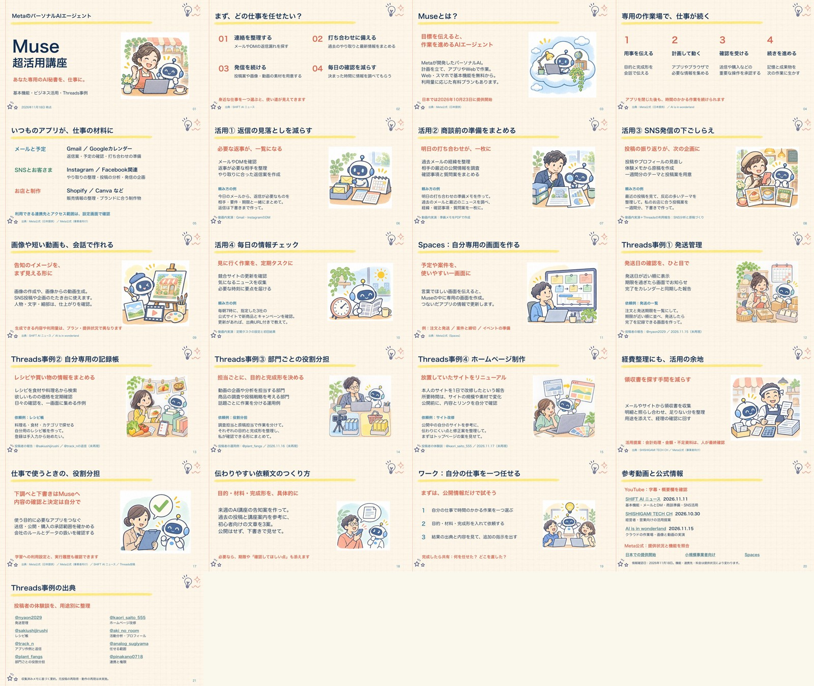

# Muse AIセミナー

MetaのパーソナルAIエージェント「Muse」の基本機能とビジネス活用を紹介する、日本語セミナー資料です。このチャットで行った参考スライドの分析、YouTubeを起点とする調査、Threadsの利用事例、作成済み21枚のスライドをまとめています。

**情報確認日：2026年11月18日**。製品の機能・提供地域・連携先・料金は変わるため、開催前に公式情報を再確認してください。

## スライド

- [PowerPoint（編集用・全21枚）](slides/muse-ai-seminar.pptx)
- [PDF（配布・閲覧用）](slides/muse-ai-seminar.pdf)
- [スライド一覧](slides/overview.jpg)
- [全ページのプレビュー](slides/previews/)
- [スライド原稿と講師用ノート](slides/script.md)

## 調査とデザイン

- [Museの基本機能・ビジネス活用](research/muse-research.md)
- [Threadsの活用事例調査](research/threads-muse-usage-2026-11-18.md)
- [出典一覧と確認範囲](research/sources.md)
- [出典データ（CSV）](research/sources.csv)
- [参考スライドの雰囲気と共通するデザイン](docs/design-analysis.md)
- [依頼文・体験ワーク](docs/workshop-prompts.md)
- [作成の経緯と資料の扱い](docs/project-context.md)
- [挿絵・背景素材](assets/)
- [スライド内容データ](src/slides.json)
- [スライド生成スクリプト](src/build-presentation.mjs)

## 内容

1. Muse 超活用講座
2. まず、どの仕事を任せたい？
3. Museとは？
4. 専用の作業場で、仕事が続く
5. いつものアプリが、仕事の材料に
6. 活用① 返信の見落としを減らす
7. 活用② 商談前の準備をまとめる
8. 活用③ SNS発信の下ごしらえ
9. 画像や短い動画も、会話で作れる
10. 活用④ 毎日の情報チェック
11. Spaces：自分専用の画面を作る
12. Threads事例① 発送管理
13. Threads事例② 自分専用の記録帳
14. Threads事例③ 部門ごとの役割分担
15. Threads事例④ ホームページ制作
16. 経費整理にも、活用の余地
17. 仕事で使うときの、役割分担
18. 伝わりやすい依頼文のつくり方
19. ワーク：自分の仕事を一つ任せる
20. 参考動画と公式情報
21. Threads事例の出典

## 編集・利用について

PowerPointの文字・配置は編集できます。挿絵は説明用のAI生成イラストで、Metaの公式キャラクターや製品画面ではありません。PDFは確認済みスライドの画像をまとめた閲覧用です。本文・挿絵についてライセンスの新規付与は行っていません。参照動画・公式サイト・元資料の権利は各権利者に帰属します。

元の参考PDFとYouTubeの字幕全文は再配布していません。リンク先を参照してください。
